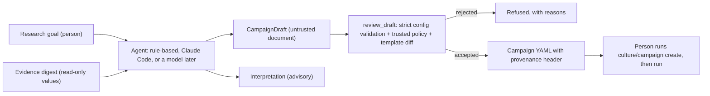

# Research agents (stage 7)

Status: **first slice implemented.** The agent boundary, a rule-based agent with no
model and no cost, and CLI tools that let an external agent such as Claude Code act as
AutoLab's research agent. No hosted-model API is called anywhere. Literature retrieval
is not implemented.

## The boundary



- Agents (`autonomous_lab.agents`) produce documents only. An architecture test forbids
  the package from importing hardware, orchestration, protocols, validation, campaigns,
  storage, culture, optimisation or simulation code.
- `campaigns/agent_gateway.py` is the only bridge, and it runs in one direction each way.
  - **Out:** `build_digest` gives an agent values and statuses, never file paths, device
    handles or credentials.
  - **In:** `review_draft` validates a draft with the same strict loader as hand-written
    configs. Culture ranges are also checked against the trusted policy, and any change
    to the template's execution sections is flagged for human sign-off.
- Accepted drafts become campaign YAML whose header records the agent, goal and draft
  SHA-256. The header is part of the campaign source text, so `create` stores it with
  the campaign. Creating and running stay with a person.

## The built-in agent: `TemplateResearchAgent`

- **Drafts** by adapting an operator-chosen template. It sets the name, objectives and
  budget, and may only *narrow* parameter ranges. Every change and assumption is listed.
- **Interprets** with rules:
  - the best result per objective;
  - how much of each parameter range was explored, with a suggestion to widen if under
    half;
  - QC failure patterns;
  - Pareto-front size;
  - contamination flags (flagged runs are excluded from "best").

  Confidence reflects evidence volume, not statistics.

It is a baseline that a model-backed agent should beat, and it keeps CI deterministic.

## Claude Code as the agent

`.claude/skills/autolab-research-agent/SKILL.md` teaches Claude Code the workflow and its
limits. It may read digests, write drafts and review them. It must not create or run
campaigns, edit policies, or change execution settings. Claude Code is a separate
tool and doesn't depend on AutoLab code; AutoLab simply treats its output as untrusted.

```bash
uv run autolab agent digest <campaign-id>          # what the agent may read
uv run autolab agent interpret <campaign-id>       # rule-based baseline
uv run autolab agent draft configs/agent/goal-example.yaml \
    --template configs/culture-algae-sim.yaml -o data/agent-drafts/draft.yaml
uv run autolab agent review data/agent-drafts/draft.yaml \
    --template configs/culture-algae-sim.yaml --write-config data/agent-drafts/campaign.yaml
uv run autolab culture create data/agent-drafts/campaign.yaml   # a person decides
```

`review` exits with 0 when the draft is accepted and 2 when it is rejected.

## Later

- A model-backed `ResearchAgent` (a local model, or a hosted API if costs allow) behind the
  same protocol. Recorded responses would keep CI offline.
- An MCP server exposing the same read-only digest and review tools.
- Literature retrieval, and retraction of observations later flagged as contaminated.
