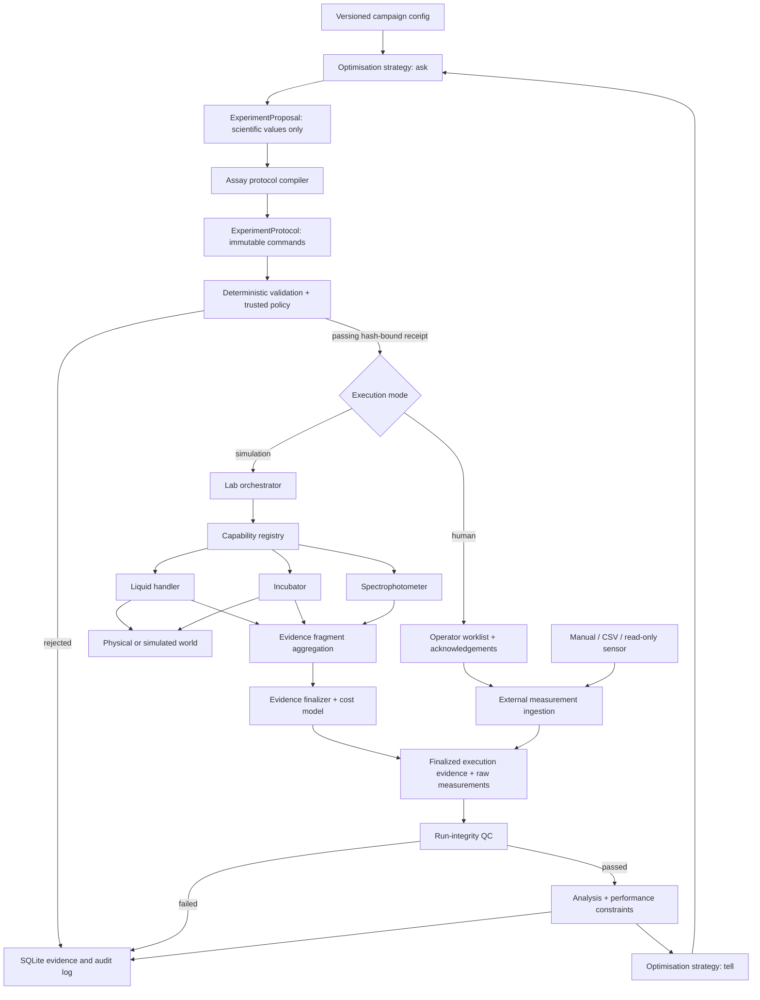

# Architecture

AutoLab is a local modular monolith. Module boundaries are ordinary Python contracts;
SQLite is the authoritative evidence store. This keeps failure handling and
transactions understandable while preserving seams for other optimisers, simulators,
and physical device adapters.

## Dependency direction

- `domain` contains stable wire contracts and imports no application service.
- `optimization` emits parameter values and never imports hardware or orchestration.
- `protocols` converts a proposal and campaign design into device-neutral commands.
- `validation` is the only issuer of executable receipts.
- `orchestration` accepts only an `ExecutableProtocol` and dispatches typed commands.
- `hardware` exposes capabilities and translates commands; adapters do not choose
  experiments. Devices attest only to local evidence facts; the backend supplies a
  neutral finalizer that composes and validates the whole-run evidence.
- `simulation` implements the hidden world behind the same hardware boundary.
- `human` emits operator-facing, hash-bound worklists and records acknowledgements;
  it neither creates measurements nor imports the assay simulator.
- `measurement_ingestion` reconciles immutable external batches against the expected
  plan and preserves revisions, source metadata, and file/batch hashes.
- `hardware.sensors` is a narrow read-only physical boundary. Sensor adapters return
  raw evidence and do not perform QC, analysis, or scientific interpretation.
- `qc` decides whether a run is trustworthy. `analysis` computes scientific metrics.
- `storage` persists the immutable evidence chain and state transitions.
- `campaigns` owns the closed-loop lifecycle and is the only layer that joins all of
  these concerns.

## Trust boundaries

Campaign configuration and future agent output are untrusted inputs. The installed
validation policy, validator implementation, capability snapshot, device adapter
bounds, and physical interlocks form progressively lower safety layers. A campaign
cannot weaken installation policy.

The research-agent boundary accepts structured campaign drafts and summaries only.
It has no reference to the orchestrator or device registry.

## Failure model

Machine execution is sequential in V0. Human campaigns are intentionally
asynchronous: they pause at `AWAITING_EXECUTION` and `AWAITING_MEASUREMENTS`, and no
CLI process needs to remain alive. Each step-start event is durable before dispatch.
Only explicitly retry-safe commands may be replayed. A sensor read can be retried;
an ambiguously acknowledged dispense cannot. Unresolved errors request safe state
from every registered device and end the execution attempt. Missing, malformed, or
conflicting terminal evidence fails the experiment and pauses the campaign at the
experiment boundary so it cannot silently consume the remaining budget.
