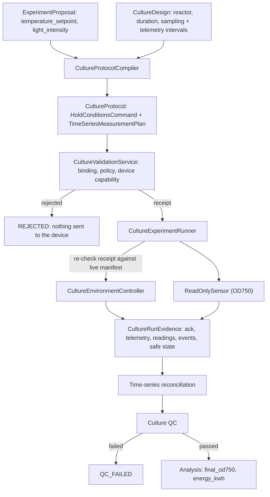

# Biological culture (stage 6, slice A)

Status: **contracts and an in-memory runner only.** A single culture experiment
can be compiled, validated, executed against a setpoint-accepting controller,
sampled as a time series, quality-checked and analysed. It is not yet persisted
to SQLite or driven by `CampaignService`; that is slice B. No real bioreactor has
been driven. The QC thresholds and metrics are illustrative and are not validated
biology.

## Why a separate protocol type

An assay protocol is a short list of liquid-handling commands ending in one plate
read. A culture holds conditions for hours and samples throughout. Adding
"hold for 24 h" to the assay step union would weaken validation for both, so
`autonomous_lab.culture` has its own protocol, plan and receipt. It reuses
`ExperimentProposal`, `QuantityValue`, `ValidationIssue`/`ValidationReport`,
canonical hashing, the read-only sensor contract and the experiment state machine
unchanged.

## Pieces

| Module | Responsibility |
| --- | --- |
| `models.py` | `CultureDesign`, `HoldConditionsCommand`, `TimeSeriesMeasurementPlan`, `CultureProtocol`, trusted `CulturePolicy`, `CultureControllerCapabilities`, the `ExecutableCultureProtocol` receipt, and `CultureQCConfig` |
| `compiler.py` | Deterministic proposal + design → protocol. Readings every `sampling_interval` plus one at the end of the hold |
| `validation.py` | The only issuer of culture receipts. Validation recompiles the protocol and compares it, rather than trusting the submitted copy |
| `controller.py` | The setpoint-accepting device contract, its evidence models, `ControllerError`, and the `autonomous_lab.culture_controllers` entry-point registry |
| `clock.py` | `WallClock` for hardware (it really waits) and `SteppedClock` for simulation and tests (it jumps ahead and notifies listeners) |
| `timeseries.py` | Matches readings to plan entries: matched, out of window, missing, or unexpected |
| `qc.py` | Run-integrity checks (see below) |
| `analysis.py` | Final OD750 and the energy the device reports using during the hold |
| `runner.py` | Joins the pieces for one experiment and records every state change through the domain state machine |

## Validation rules

- **Binding**: the compiler is trusted, and the protocol hash, experiment, proposal
  hash and design hash all match. The hold and the sampling plan must equal a fresh
  compilation.
- **Policy**: setpoint and light are within the installation's ranges and
  resolution. Duration, sample count and spacing are bounded. The final reading
  falls at the end of the hold.
- **Device capability**: the reactor exists on the controller. Setpoint, light and
  duration are within the controller's manifest. The setpoint stays at least
  `minimum_trip_margin` below the device's own over-temperature trip.

The receipt binds the protocol, policy and capability hashes. Before sending
anything, the runner fetches the manifest again and refuses with `receipt_stale` if
it changed.

## Commandable device seam

`CultureEnvironmentController` is the first AutoLab plug-in that can change the
physical world, so it has more obligations than `ReadOnlySensor`:

- `apply_setpoints` returns a `SetpointAcknowledgement` carrying the **applied**
  values. QC fails the run if they differ from the requested values.
- The adapter re-checks its own limits even after upstream validation passed.
- `read_telemetry` reports only what the device can attest to: measured
  temperature (`None` when the probe drops out), applied setpoints, protection
  trips and cumulative energy.
- `enter_safe_state` is called on **every** exit path: normal completion, device
  refusal, a protection trip, a failed command, and cancellation. If safe state is
  not confirmed, the run is marked failed as `ambiguous_device_state`.
- A `ControllerError` with `ambiguous=True` (the device may have acted) is never
  retried. Read-only telemetry failures are recorded as gaps.
- Local protection, such as an over-temperature trip, belongs to the device and must
  work with AutoLab disconnected. AutoLab only reads whether it fired, then stops
  the hold early.

Adapters are installed packages exposing a factory in the
`autonomous_lab.culture_controllers` entry-point group. The factory receives
`controller_id` and `settings`. The registry checks the returned object at runtime
and verifies its identity.

## Culture QC

| Check | Fails when |
| --- | --- |
| `setpoint_acknowledged` | the device did not accept the setpoints, or applied different values |
| `no_protection_trip` | any telemetry sample reports a trip |
| `telemetry_coverage` | too few post-warm-up samples have a measured temperature |
| `temperature_control` | the mean absolute deviation from the setpoint after warm-up exceeds the limit |
| `readings_complete` | too many plan entries are missing or out of window, or the final reading is missing |
| `no_unexpected_readings` | a reading is a duplicate or matches no plan entry |
| `no_sensor_saturation` | a reading is flagged saturated or sits at the sensor range limit |
| `calibration_valid` | a reading falls outside its calibration's validity or has a mismatched calibration hash |

A QC failure is terminal and is not learned as a scientific observation, just as
on the assay path.

## Not yet (later slices)

- **Slice B**: persist culture records in the existing JSON-snapshot tables, add
  `experiment_type: culture` to campaign config, let `CampaignService` select the
  culture compiler and runner, and add CLI commands.
- Pause and resume part-way through a multi-day hold, across process restarts.
- Batch proposals for parallel reactors.
- Time-series storage beyond per-experiment evidence.
- Contamination handling, inoculum and biological-replicate semantics, and
  growth-rate fitting.
- A real adapter. The simulated photobioreactor in the separate `algae-sim` project
  is the intended first controller and sensor pair.
