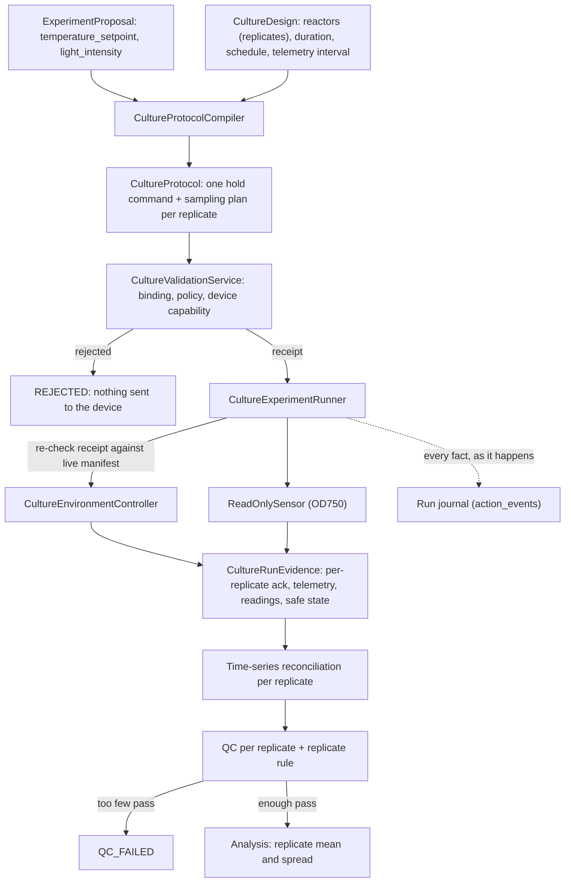

# Biological culture (stage 6)

Status: **stage 6 is complete for simulation and contract testing.** A culture
campaign:

- holds temperature and light on one or more replicate reactors;
- samples optical density on a regular or explicit schedule;
- quality-checks each replicate, including contamination screens;
- learns from the mean of the replicates that pass, with their spread kept as
  uncertainty;
- persists a full evidence trail and survives AutoLab restarting in the middle of a
  multi-day hold.

Only scripted contract fakes have driven it so far; no real bioreactor has. The QC
thresholds, contamination screens and metrics are illustrative and are not
validated biology. Unattended physical culture remains out of scope (see the
roadmap).

```bash
uv run autolab culture create configs/culture-algae-sim.yaml --policy configs/culture-policy.yaml
uv run autolab culture run <campaign-id>            # also resumes an interrupted culture
uv run autolab campaign status <campaign-id>
uv run autolab culture report <campaign-id>
uv run autolab culture reconcile <campaign-id> <experiment-id> --operator NAME --reason TEXT
uv run autolab culture flag-contamination <campaign-id> <experiment-id> --operator NAME --reason TEXT
```

`culture run` needs an installed controller adapter (see
[Commandable device seam](#commandable-device-seam)). The example config expects
`algae-sim-reactor` from the separate algae-sim project.

## Why a separate protocol type

An assay protocol is a short list of liquid-handling commands ending in one plate
read. A culture holds conditions for hours and samples throughout. Adding
"hold for 24 h" to the assay step union would weaken validation for both, so
`autonomous_lab.culture` has its own protocol, plan and receipt. It reuses
`ExperimentProposal`, `QuantityValue`, `ValidationIssue`/`ValidationReport`,
canonical hashing, the read-only sensor contract and the experiment state machine
unchanged.



## Pieces

| Module | Responsibility |
| --- | --- |
| `models.py` | `CultureDesign`, `CultureReplicate`, `HoldConditionsCommand`, `TimeSeriesMeasurementPlan`, `CultureProtocol`, trusted `CulturePolicy`, `CultureControllerCapabilities`, the `ExecutableCultureProtocol` receipt, and `CultureQCConfig` |
| `compiler.py` | Deterministic proposal + design → protocol, with one hold command and sampling plan per replicate reactor |
| `validation.py` | The only issuer of culture receipts. It recompiles the protocol and compares, rather than trusting the submitted copy |
| `controller.py` | The setpoint-accepting device contract, its evidence models, `ControllerError`, `IntegratedCultureSensor`, and the `autonomous_lab.culture_controllers` registry |
| `clock.py` | `WallClock` for hardware (it really waits) and `SteppedClock` for simulation and tests |
| `timeseries.py` | Matches readings to plan entries: matched, out of window, missing, or unexpected |
| `qc.py` | Per-replicate run-integrity checks and the experiment-level replicate rule |
| `analysis.py` | Per-replicate final OD750 and energy, then the mean, standard deviation and standard error over passing replicates |
| `runner.py` | Runs one experiment on all its reactors and writes the journal. `resume` continues an interrupted one |
| `campaigns/culture_config.py` | The `experiment_type: culture` campaign document |
| `campaigns/culture_service.py` | `CultureCampaignService`: ask → run → persist → tell, plus recovery, `reconcile` and `flag_contamination` |
| `campaigns/lifecycle.py` | `CampaignLedger`, shared with assay campaigns |

## Biological replicates

`culture_design.reactor_ids` lists one reactor per biological replicate. Every
replicate gets the same conditions at the same time and has its own setpoint
command, telemetry, readings and safe state.

- **QC per replicate**: a heater fault on one reactor fails only that replicate.
- **Replicate rule**: the experiment passes if at least
  `minimum_passing_replicates` replicates pass (default: all of them).
- **Analysis**: each metric is the mean over passing replicates. The standard
  deviation, standard error and n are stored with the metric, and the standard
  error goes to the optimiser as measurement uncertainty. Failed replicates are
  excluded, never averaged in.
- **Starting the hold**: setpoints are applied reactor by reactor. If any reactor
  refuses, the experiment fails and every reactor that received a setpoint is put
  in safe state, so replicates never start out of step.
- A protection trip on one reactor stops and safe-states that reactor only. The
  others continue.

Replicates here are *parallel reactors at the same conditions*. Running
*different* conditions in parallel (batch proposals) is optimiser-scheduling work
for a later stage.

## Sampling schedules

Give exactly one of `sampling_interval` (a reading every interval plus one at the
end) or `sample_offsets` (an explicit list, for example denser during early growth).
Tolerance windows must be less than half the smallest gap between readings, so one
reading can never satisfy two plan entries. The final reading must coincide with
the end of the hold. Telemetry is polled every `telemetry_interval` and at both
ends of the hold.

## Validation rules

- **Binding**: the compiler is trusted, and the protocol hash, experiment, proposal
  hash and design hash all match. Every replicate's hold command, every sampling
  plan, the telemetry interval and the replicate rule must equal a fresh
  compilation.
- **Policy**: setpoint and light are within the installation's ranges and
  resolution. Duration, sample count, sample spacing and the replicate count
  (`maximum_replicates`) are bounded. The final reading falls at the end of the hold.
- **Device capability**: every reactor exists on the controller. Setpoint, light and
  duration are within the controller's manifest. The setpoint stays at least
  `minimum_trip_margin` below the device's own over-temperature trip.

The receipt binds the protocol, policy and capability hashes. Before sending
anything, the runner fetches the manifest again and refuses with `receipt_stale` if
it changed.

## Commandable device seam

`CultureEnvironmentController` is the first AutoLab plug-in that can change the
physical world, so it has more obligations than `ReadOnlySensor`:

- `apply_setpoints` returns a `SetpointAcknowledgement` carrying the **applied**
  values. QC fails the replicate if they differ from the requested values.
- The adapter re-checks its own limits even after upstream validation passed.
- `read_telemetry` reports only what the device can attest to: measured
  temperature (`None` when the probe drops out), applied setpoints, protection
  trips, cumulative energy and fault codes. It should also report
  `active_command_id`, the command it is holding; without it AutoLab cannot resume
  a hold after a restart and can only end it safely.
- `enter_safe_state` is requested for every reactor that may have received a
  setpoint, on every exit path except a deliberate detach (below). If safe state is
  not confirmed, the run fails as `ambiguous_device_state`.
- A `ControllerError` with `ambiguous=True` (the device may have acted) is never
  retried. Read-only telemetry failures are recorded as gaps.
- Local protection, such as an over-temperature trip, belongs to the device and must
  work with AutoLab disconnected.

Adapters are installed packages exposing a factory in the
`autonomous_lab.culture_controllers` entry-point group. The factory receives
`controller_id`, `settings` and the run's `clock`: simulated adapters advance their
world from the clock, and hardware adapters ignore it. A controller with a built-in
OD probe implements `IntegratedCultureSensor.culture_sensor()`, and the campaign
then omits `execution.sensor`.

`execution.clock: simulated` skips real waiting. The campaign refuses it unless the
controller's manifest declares `is_simulated`. With real hardware it would sample a
culture minutes after it started and record that as 24 hours.

## Long-running state: journal, resume and reconcile

Multi-day cultures must survive AutoLab stopping.

1. **Journal.** Before the first setpoint, the dispatch header is written to
   `execution_runs`. It holds the receipt, every planned command, the sensor
   snapshot and the validation report. From then on every setpoint command (written
   *before* it is sent), acknowledgement, hold start, telemetry sample, reading,
   safe-state result and run event is committed to `action_events` as it happens.
2. **Interrupt policy.** `execution.on_interrupt` decides what a cancelled run
   (Ctrl-C, shutdown) does:
   - `safe_state` (the default) ends the hold;
   - `keep_holding` *detaches*: the device keeps holding under its own local control
     and protection.

   Any other exception always requests safe state.
3. **Recovery on the next `culture run`.** The service rebuilds the run from the
   journal and does one of the following:
   - **No setpoint was journalled**: nothing reached a device. The experiment fails
     as `interrupted_before_dispatch`, and the campaign continues.
   - **A setpoint was sent but the hold never started**: this is ambiguous. Every
     reactor that may have received one is safe-stated, and the run fails.
   - **The hold was running**: each reactor must report `active_command_id` equal
     to its acknowledged command with no trip.
     - Confirmed reactors continue the schedule. A reading whose tolerance window
       is still open is taken late and counts; one whose window closed during the
       outage is recorded as missing. QC then judges completeness and telemetry
       coverage, counting the outage as a gap.
     - A reactor that cannot confirm is marked `hold_interrupted`, safe-stated, and
       fails the `hold_continuous` check.
   - **The hold had already ended safely** (for example after a crash): the run is
     concluded from the journal without an operator.
   - **The controller cannot be reached**: the campaign pauses with
     `CultureResumeError`. An operator checks the reactor and runs
     `autolab culture reconcile`. That marks the experiment ABORTED (never learned
     from), records who did it and why, and lets the campaign continue.

   After a restart the sensor may report a different calibration. Each reading is
   checked against the calibration its own evidence names, from any recorded sensor
   session.

## Contamination handling

Three automatic screens run per replicate, plus a manual flag for contamination
found later. None of them proves contamination on its own; they make suspicious
runs visible and keep them out of learning.

| Check | Fails when |
| --- | --- |
| `no_contamination_indicator` | the device reports a code in `contamination_fault_codes`, or a reading's metadata says `contamination_suspected` |
| `growth_plausible` | OD drops by more than `maximum_od_drop` between consecutive readings (lysis, grazing, fouling), or the apparent specific growth rate exceeds `maximum_specific_growth_rate_per_hour`. Either limit can be set to `null` to disable it |
| `autolab culture flag-contamination` | an operator later finds contamination (microscopy, plating). This is an append-only audit event. The report lists the flag and drops the run from the Pareto front |

A post-hoc flag does **not** retrain the optimiser: it has already learned from
that observation, and the report says so. Retracting observations from optimisers
is left for a later stage.

## Culture QC (per replicate)

| Check | Fails when |
| --- | --- |
| `setpoint_acknowledged` | the device did not accept the setpoints, or applied different values |
| `hold_continuous` | the device could not confirm it kept holding across a restart |
| `no_protection_trip` | any telemetry sample reports a trip |
| `telemetry_coverage` | too few post-warm-up samples (against the *expected* count) have a measured temperature |
| `temperature_control` | the mean absolute deviation from the setpoint after warm-up exceeds the limit |
| `readings_complete` | too many plan entries are missing or out of window, or the final reading is missing |
| `no_unexpected_readings` | a reading is a duplicate or matches no plan entry |
| `no_sensor_saturation` | a reading is flagged saturated or sits at the sensor range limit |
| `calibration_valid` | a reading's calibration is unknown, not valid at that time, or mismatched |
| `no_contamination_indicator`, `growth_plausible` | see [Contamination handling](#contamination-handling) |

A QC failure is terminal and is not learned as a scientific observation, just as
on the assay path.

## Evidence and storage

| Evidence | Where it is stored |
| --- | --- |
| Proposal, protocol, validation report (with the policy and the controller manifest) | `proposals`, `protocols`, `validation_reports` |
| Dispatch header and the run journal | `execution_runs`, `action_events` |
| Each OD reading, with reactor, replicate, sensor, calibration hash and plan entry | `measurements` |
| Culture QC per replicate | `qc_runs` |
| `final_od750`, `energy_kwh` (mean, with SD, SE, n and per-replicate values) | `derived_metrics`, `experiment_results` |
| Optimiser observation (outbox) | `optimizer_observations` |
| Operator reconciliations and contamination flags | `audit_events` |
| The complete run record (all series, reconciliations, transitions) | a content-addressed JSON artifact, registered in `artifacts` with its SHA-256 |

QC, metrics, the result, later transitions and the optimiser outbox row commit in
**one** transaction.

Dispositions:

- **Rejected**: the optimiser is told, and the campaign continues.
- **QC failed**: the run is excluded from learning, and the campaign continues.
- **Execution failed** (device refusal, stale receipt, sensor not ready, ambiguous
  state): the evidence is persisted and the **campaign pauses**.
- **Aborted** (operator reconcile): excluded, and the campaign can continue.

`autolab campaign run/report` refuse culture campaigns, and `autolab culture ...`
refuses assay campaigns. `autolab campaign status` works for both.

## Deliberately outside stage 6

- Unattended physical culture, and validated thresholds for any real organism or
  device.
- Batch proposals (different conditions on parallel reactors at once) and
  multi-campaign reactor scheduling: stage 8.
- Optimiser retraction of observations later flagged as contaminated.
- Inoculum tracking, growth-rate model fitting, and time-series storage beyond
  per-experiment evidence (a separate data-pipeline project is planned).
- A real adapter. The simulated photobioreactor in the separate `algae-sim` project
  is the intended first controller and sensor pair.
