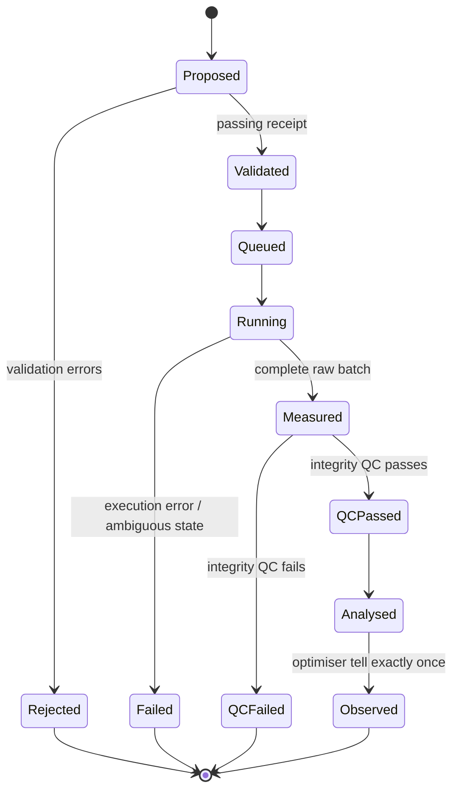
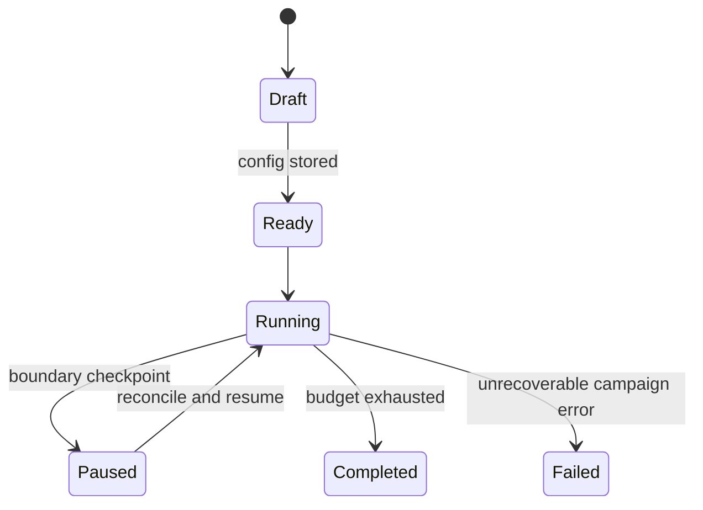

# Experiment lifecycle

Campaign and experiment transitions are enforced domain state machines and recorded
as audit events.

An experiment rejected before execution is reported to the optimiser as rejected,
not assigned fabricated objective values. Execution and integrity-QC failures are
also terminal feedback but are not learned as scientific observations. A valid,
poor-performing recipe is observed with positive constraint residuals so constrained
optimisation can learn where infeasible scientific regions lie.

Resume occurs at experiment boundaries in V0. The campaign reconciles persisted
trials and checkpoints before asking for another suggestion, preventing duplicate
`tell` calls or accidental repeated physical work.
